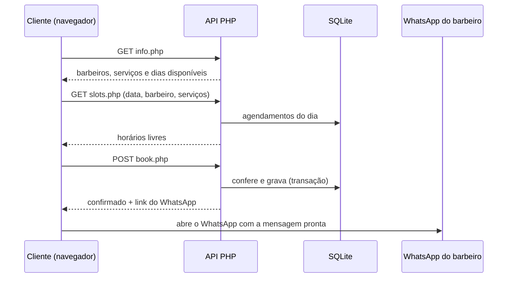

# Agendamentos Online

Sistema de agendamento online para barbearias. O cliente escolhe o barbeiro, os serviços, o dia e o horário em poucos passos, e ao confirmar o **WhatsApp do barbeiro abre com os dados do agendamento já escritos**. Um horário reservado fica indisponível para os demais clientes.

O projeto traz exemplos de barbeiros e serviços. Tudo se ajusta em um único arquivo, o `config.php`.

## Tecnologias

| Camada | Tecnologia | Uso |
| --- | --- | --- |
| Backend | **PHP 8.1+** | API em arquivos simples (`public/api/`), regras de agenda e validações |
| Banco de dados | **SQLite** (via PDO) | Guarda os agendamentos em um arquivo local, sem servidor de banco |
| Frontend | **TypeScript** | Interface em etapas, compilada para JavaScript (`src/app.ts` → `public/app.js`) |
| Frontend | **JavaScript, HTML e CSS** | Sem framework: o `app.js` gerado roda direto no navegador |
| Integração | **WhatsApp** (link `wa.me` ou Cloud API da Meta) | Envio da confirmação ao barbeiro |
| Ferramentas | **Node.js + tsc** | Só para recompilar o TypeScript |

## Como funciona o agendamento

O cliente passa por cinco etapas:

1. **Seus dados:** nome, WhatsApp com DDD e e-mail (opcional).
2. **Barbeiro:** escolhe com quem quer ser atendido.
3. **Serviços:** marca um ou mais serviços. Duração e valor total são somados na hora.
4. **Data e horário:** calendário com os dias de atendimento (padrão: segunda a sexta) e os horários livres para aquele barbeiro e aqueles serviços.
5. **Confirmação:** resumo com todos os dados. Ao confirmar, o horário é reservado e o WhatsApp do barbeiro abre com a mensagem pronta.

Na tela final o cliente pode **fazer um novo agendamento** ou **ver os seus agendamentos**.

### Mensagem enviada ao barbeiro

```
✂️ Novo agendamento - Barbearia Exemplo

👤 Cliente: Vitor Souza
💈 Profissional: Rafael Costa
🧾 Serviços: Disfarçado / Degradê + Barba
📅 Data: 09/11/2026 (segunda-feira)
🕒 Horário: 13:30 (85 min)
💰 Total: R$ 65,00
📞 Telefone: (22) 98151-3033
```

O e-mail aparece na mensagem quando o cliente o informa.

### Regras da agenda

- Um horário de início só aparece se o **atendimento inteiro cabe** no expediente, fora do almoço e sem encostar em outro agendamento do mesmo barbeiro. Um serviço de 90 min às 08:00 bloqueia a agenda até as 09:30.
- Cada barbeiro tem a **própria agenda**: o mesmo horário pode estar livre com um e ocupado com outro.
- **Duração e preço são calculados no servidor**, nunca confiados ao navegador.
- Datas passadas, fins de semana (ou outros dias sem atendimento) e datas além da janela configurada são recusados pelo servidor.
- Dois clientes que confirmam **ao mesmo tempo** o mesmo horário não conseguem reservá-lo: a gravação roda numa transação do SQLite (`BEGIN IMMEDIATE`) que confere a disponibilidade e grava em seguida. O segundo cliente recebe um aviso e volta para escolher outro horário.

### Meus agendamentos

O cliente informa o **nome e o WhatsApp** usados na reserva e vê os próximos horários: dia, hora, serviços, barbeiro, duração e total.

- A busca só devolve agendamentos em que o telefone **e** o primeiro nome batem (sem diferenciar maiúsculas e acentos).
- E-mail e dados de outros clientes nunca aparecem.
- O navegador lembra nome, WhatsApp e e-mail no mesmo aparelho, então a lista abre sozinha nas próximas visitas. Ao clicar em **Fazer novo agendamento**, o formulário volta vazio e esses dados lembrados são apagados, o que evita que o próximo cliente de um aparelho compartilhado veja dados alheios.

## Arquitetura



### Estrutura de pastas

```
config.php          barbearia, horários, barbeiros, serviços e WhatsApp
lib.php             banco, regras de agenda, mensagens e envio de WhatsApp
public/             única pasta que deve ficar acessível na web
  index.html        página
  style.css         estilos
  app.js            gerado a partir de src/app.ts (já incluído)
  api/info.php      GET   barbeiros, serviços e dias disponíveis
  api/slots.php     GET   horários livres (data + barbeiro + serviços)
  api/book.php      POST  cria o agendamento
  api/my.php        GET   próximos agendamentos (telefone + nome)
src/app.ts          código TypeScript do frontend
preview.html        pré-visualização sem PHP (dados simulados no navegador)
data/               banco SQLite, criado automaticamente (fora do Git)
```

### API

| Rota | Método | Parâmetros | Resposta |
| --- | --- | --- | --- |
| `api/info.php` | GET | nenhum | `shop_name`, `professionals`, `services`, `dates` |
| `api/slots.php` | GET | `date`, `professional`, `services` (ids separados por vírgula) | `times`: horários de início livres |
| `api/book.php` | POST (JSON) | `name`, `phone`, `email`, `professional_id`, `service_ids`, `date`, `time` | `booking`, `whatsapp_sent`, `whatsapp_link`. Erro 409 se o horário foi ocupado |
| `api/my.php` | GET | `phone`, `name` | `bookings`: próximos agendamentos |

## Como rodar

Requisitos: **PHP 8.1+** com as extensões `pdo_sqlite` e `curl`. Node.js só é necessário para editar o TypeScript.

```bash
php -S localhost:8000 -t public
```

Abra `http://localhost:8000`. O banco é criado sozinho em `data/agenda.sqlite`.

Para alterar a interface:

```bash
npm install
npm run build      # recompila src/app.ts para public/app.js
npm run watch      # recompila a cada alteração
```

Para só ver a interface, sem PHP, abra o `preview.html` no navegador. Ele usa dados simulados.

## Configuração (`config.php`)

| Opção | O que faz |
| --- | --- |
| `shop_name` | Nome da barbearia |
| `open`, `close` | Horário de funcionamento |
| `lunch` | Intervalo sem atendimento (`null` desativa) |
| `work_days` | Dias de atendimento (1 = segunda … 7 = domingo) |
| `days_ahead` | Quantos dias à frente o cliente pode agendar |
| `slot_step` | De quanto em quanto tempo um atendimento pode começar, em minutos |
| `professionals` | Barbeiros. Cada um pode ter o próprio `whatsapp`; com `null` usa o padrão |
| `services` | Serviços com nome, duração (min) e preço. A lista incluída é um exemplo |
| `barber_whatsapp` | WhatsApp padrão: DDI + DDD + número, só dígitos (ex.: `5522999999999`). Aceita a variável `BARBER_WHATSAPP` |

## WhatsApp: dois modos

1. **Padrão (funciona sem configurar):** depois de confirmar, o navegador abre o WhatsApp do barbeiro com a mensagem pronta, e o cliente só toca em enviar. Há também o botão "Abrir WhatsApp do barbeiro" como reserva.
2. **Automático (WhatsApp Cloud API da Meta):** defina as variáveis `WA_TOKEN` e `WA_PHONE_ID` e o servidor envia a mensagem sozinho. A Meta só aceita texto livre se o barbeiro falou com o número comercial nas últimas 24 horas. Fora disso é preciso um *template* aprovado (ajuste `send_whatsapp()` em `lib.php`).

## Publicação

Aponte o domínio para a pasta `public/`, assim `config.php`, `lib.php` e `data/` ficam fora do acesso web. A pasta `data/` precisa de permissão de escrita pelo PHP.

## Limitações conhecidas

- Não há cancelamento nem remarcação pelo cliente. O barbeiro cuida disso pelo WhatsApp.
- A consulta "Meus agendamentos" não limita o número de tentativas. Vale adicionar um limite se o site ficar público.
- Não há painel do barbeiro: a agenda fica no banco SQLite e nas mensagens recebidas no WhatsApp.
